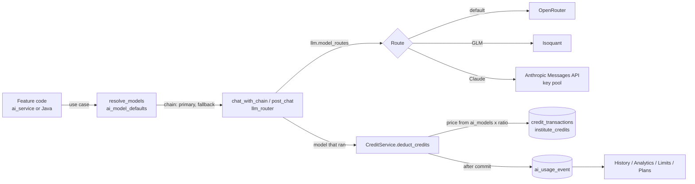

# AI models, routing, credits and usage tracking

How Vacademy chooses an AI model for every feature, how a call reaches the vendor, how the call is priced in credits, and how each use is recorded per user, per role and per feature, including usage limits.

AI subscription plans (who pays: the wallet, a plan allowance, or nobody) are in [AI_SUBSCRIPTION_PLANS.md](AI_SUBSCRIPTION_PLANS.md).

Last updated 2026-10-16. If a table, setting or path here does not match the code, the code wins; fix this page in the same PR.

Contents

1. [The picture in one screen](#1-the-picture-in-one-screen)
2. [Model registry (database)](#2-model-registry-database)
3. [How a feature picks its model](#3-how-a-feature-picks-its-model)
4. [How a call reaches the vendor (routing)](#4-how-a-call-reaches-the-vendor-routing)
5. [Image models](#5-image-models)
6. [From model price to credits](#6-from-model-price-to-credits)
7. [Usage tracking per user, role and feature](#7-usage-tracking-per-user-role-and-feature)
8. [Usage History and Analytics](#8-usage-history-and-analytics)
9. [Usage limits](#9-usage-limits)
10. [Where things are managed](#10-where-things-are-managed)
11. [Settings reference](#11-settings-reference)
12. [Access rules](#12-access-rules)
13. [Recipes](#13-recipes)
14. [Guard rails and tests](#14-guard-rails-and-tests)
15. [Changes in October 2026](#15-changes-in-october-2026)
16. [Known gaps](#16-known-gaps)

---

## 1. The picture in one screen



The core rules:

- **Models live in the database, not in code.** `ai_models` is the registry. `ai_model_defaults` gives each use case a default and a fallback model. A super admin changes them in the portal, and every change is audited.
- **A feature asks for a use case, never for a model id.** The resolver turns the use case into a chain of models. Code keeps only a last-resort safety net (`GLM_DEFAULT`, `NON_GLM_FALLBACK`), and a CI check stops new hard-coded model ids.
- **The router decides the vendor, not the feature.** By default a call goes through OpenRouter. A route map can send a model to Isoquant (GLM) or to Anthropic directly (Claude, using our own key pool). If the routed vendor fails, the call falls back to OpenRouter and then to the next model in the chain.
- **The customer price does not depend on the route.** Credits are always computed from the registry price of the model that ran (`ai_models`) times the credit ratio. Using our Claude credits instead of OpenRouter changes our cost, not the institute's charge.
- **One event per AI use.** Every charge, and every free or bundled use, writes one row to `ai_usage_event`. That row records who did it, their role class, the feature (use case), the model, the units used and what was charged. History, analytics, limits and plans all read it.
- **ai_service is the only writer of credits and events.** Java services (admin_core, assessment, community, notification) call ai_service over HTTP (`CreditClient`); they never write the ledger or the metering tables themselves.

---

## 2. Model registry (database)

All tables live in the admin_core database and are created by Flyway migrations in `admin_core_service/src/main/resources/db/migration/`. ai_service reads and writes them directly.

| Table | What it holds | Migration |
|---|---|---|
| `ai_models` | One row per model (OpenRouter-style id, for example `z-ai/glm-5.3-flash`). Provider, category (general, coding, vision, embedding, image, tts…), tier, context window, capabilities, **USD price per 1M input/output tokens**, `image_price_per_unit`, `video_price_per_second`, `is_active`, `is_free`. This is the price list credits are computed from. | V101 (+ V221 image price, V224 video price, later rows in V220/V222/V251/V373/V449/V582) |
| `ai_model_defaults` | One row per **model use case**: `default_model_id`, `fallback_model_id`, `free_tier_model_id`. | V101, rows added by V442, V569, V582 |
| `ai_model_stage_assignments` | AI video: the model for each pipeline stage and quality tier (17 stages × 5 tiers), with a fallback and a `user_overridable` flag. | V258 |
| `ai_model_change_log` | Audit trail of every portal edit to defaults, stages, plans and limits (old value, new value, reason, actor). | V569 |
| `ai_model_alias` | Maps bare or legacy model labels to the registry id, so usage rows group correctly. | V586 |
| `ai_api_keys` | An institute's or a user's own vendor key and **preferred model** (`default_model`). This is the only per-institute model override store. | V70 |
| `ai_platform_settings` | Runtime switches edited from the portal (`setting_key` → JSONB). A missing key means the code default. The list of valid keys and their validation is in code (`platform_settings_service.py`, `SETTING_SPECS`). | V493 |
| `llm_provider_keys` | Our own vendor key pool (Anthropic today): encrypted key, org label, monthly budget (default $200), soft limit %, weight, status, cooldown/exhausted-until. Normal database roles cannot read this table. | V582 |
| `llm_key_spend` | Metered spend per pool key per month (USD, calls, errors, token counts). | V582 |
| `credit_rate_config` | The credit ratio: `usd_to_credits × (1 + margin_pct/100)`. Append-only. Today 100 × 1.5 = **150 credits per USD**. | V252 |
| `credit_pricing`, `ai_tool_pricing`, `model_pricing` | Base cost, minimum charge and token rate per request type; parametric per-tool prices (per page, per minute…) with per-institute overrides; legacy pattern multipliers used only by the fallback formula. | V100, V321, V322, V190 |

State on production (2026-10-16): 46 of 48 registry models are active; GLM 5.3 Flash is the default for 42 use cases; image use cases default to dedicated image models (Gemini Flash Image, Qwen Image, Recraft and others).

---

## 3. How a feature picks its model

### 3.1 Use cases

A **model use case** is the name a feature uses to ask for a model: `content`, `questions`, `outline`, `assistant`, `analytics`, `chat`, `image`, `copilot` and so on. The list of 52 is in `ai_service/app/constants/model_use_cases.py`, grouped as Learner, Content, Assessment, Video, Admin and Platform. Each one has a row in `ai_model_defaults`.

Do not confuse this with the **metering use case** in `ai_use_case_catalog` (section 7.2), which names what was billed (57 rows). The catalog column `model_use_case` links the two. A CI test (`test_metering_catalog_coverage.py`) keeps them in sync.

### 3.2 The resolver

`resolve_models(db, use_case, preferred_model)` in `ai_service/app/services/model_selection.py` returns `(primary, fallbacks)`:

1. the **preferred model**, but only if it exists in `ai_models` and is active;
2. the use case's `default_model_id`;
3. its `fallback_model_id`;
4. the code safety net `GLM_DEFAULT` (`z-ai/glm-5.3-flash`);
5. if every model so far is GLM, `NON_GLM_FALLBACK` (`google/gemini-2.5-flash`) is added, so one vendor outage cannot take a feature down.

Rows are cached in-process for 30 seconds (a failed read is not cached), and a portal write clears the cache. `resolve_model_sync()` is the version for code without a database session; it never raises.

Helpers built on it:

- `use_case_chat.models_for(use_case, explicit=, env=)`: an explicit or environment override first, then the chain. `chat_json()` retries the chain without `response_format` when a model rejects it.
- `AIModelsService.get_stage_model_map()`: AI video. The stage matrix is the floor; a user's choice applies only where `user_overridable` is true.

### 3.3 Where a "preferred model" comes from

`ApiKeyResolver.resolve_keys()` (`ai_service/app/services/api_key_resolver.py`), in this order:

1. the model in the request (unless it is `auto`);
2. the user's `ai_api_keys.default_model`;
3. the institute's `ai_api_keys.default_model` (set in the admin app, AI Settings);
4. a platform setting, where the feature has one (for example `chatbot.text.model`, `tutor.live.model`);
5. `resolve_models(db, "platform_default")`;
6. the environment default.

A preferred model only wins if it is active in the registry. A model that a user or institute picked explicitly is also never covered by a plan's "default model only" rule (see the plans doc).

### 3.4 Java services

admin_core has the same logic: `AiModelDefaultsResolver.java` builds [default, fallback, non-GLM tail] from `ai_model_defaults` with a 60-second cache, and `ModelDefaults.java` holds the same two safety-net ids. Java LLM calls go through ai_service's internal bridge (`/ai-service/internal/llm/v1/chat/completions`), so Java never holds vendor keys and gets the same routing and metering.

---

## 4. How a call reaches the vendor (routing)

### 4.1 The router

`ai_service/app/services/llm_router.py` knows three gateways:

| Router | Used for | Notes |
|---|---|---|
| `openrouter` | Default for every model | OpenAI-compatible. Always the fallback. |
| `isoquant` | GLM models | OpenAI-compatible; zero-data-retention header; reasoning effort low/high/max (default low). |
| `anthropic` | Claude models, using our key pool | Native Messages API through `llm_providers/anthropic_adapter.py` (OpenAI format in, OpenAI format out; prompt-cache breakpoints). |

The **route map** is the platform setting `llm.model_routes` (model id → router), validated on save. Production today: `{"z-ai/glm-5.3-flash": "isoquant"}`. A model with no entry goes to OpenRouter.

A call stays on OpenRouter, even when routed, if:

- the caller brought their own key (an institute's own key is never sent to another vendor);
- the routed gateway has no key configured, or is in its 120-second failure cooldown;
- for Anthropic: the caller cannot use a translated route, or no pool key has budget left.

### 4.2 Fallback order

`chat_with_chain` / `chat_with_chain_sync` walk the model chain. For each model they try the routed gateway, then the same model on OpenRouter, then the next model. An empty 2xx reply counts as a failure. GLM 5 models get reasoning "low" and extra token headroom. When everything fails they raise `ChainExhausted(use_case, attempts)`.

`post_chat` / `open_chat_stream` make one routed attempt and one OpenRouter retry. For streams the switch happens before any token is read, so the user never sees a repeated token.

The router returns the **registry id of the model that actually ran**, and that is what gets billed. The router itself charges nothing; the caller bills.

### 4.3 Claude key pool

Two or more Anthropic API keys (for example one per Anthropic organisation, each with a monthly credit grant) are stored in `llm_provider_keys`, encrypted with Fernet (`LLM_KEY_ENCRYPTION_KEY`; the pool refuses a key that equals any other shared secret). Without a usable encryption key the pool is empty and every Claude call simply goes through OpenRouter.

- **Selection** (`llm_providers/key_pool.py`): a weighted random pick among keys that are active, not cooling down or exhausted, and whose month-to-date spend plus this call's estimate stays under `monthly_budget_usd × soft_limit_pct`. The weight is scaled by the budget left, so spend spreads across keys.
- **Spend metering:** each successful call adds to `llm_key_spend` using `ai_models` prices (cache reads 0.1×, cache writes 1.25×; a model missing from the registry is priced high on purpose so the budget stops early).
- **Errors:** 401 marks the key `auth_failed`; 402 or a billing/usage-limit error marks it exhausted until the 1st of next month (UTC); 403 cools it for 10 minutes; 429 cools every key of the same org for the retry-after time (5–120 s). `_KeyWalk` moves to the next key after a key-specific refusal.

Turning Claude on for a model is two steps: add keys on the portal's "Claude keys" page, then add the model to `llm.model_routes` with router `anthropic`. Claude registry rows (Opus/Sonnet/Haiku 5.5) were seeded **inactive** by V582; activate the ones you want in the registry.

---

## 5. Image models

Image use cases (course images, page-builder images, document illustrations, quiz images and so on) pick their model through `image_model_resolver.image_model_for(use_case, hard_default)`: the use case's `default_model_id`, 30-second cache, last good value kept on a database error. Environment overrides (`PAGE_IMAGE_MODEL`, `COURSE_ASSIST_IMAGE_MODEL`, `DOC_IMAGE_MODEL`) still win.

How images are charged is controlled by `billing.image_registry_pricing`:

| Mode | Charge |
|---|---|
| `off` (default) | Flat price per image, as before |
| `shadow` (production today) | Flat price, and the registry price it *would* have charged is recorded (`would_be_credits`) for comparison |
| `on` | `image_price_per_unit` of the model that ran × the credit ratio |

AI video billing is not affected by this switch.

---

## 6. From model price to credits

### 6.1 The formula

`CreditService.calculate_credits` (`ai_service/app/services/credit_service.py`):

- **Token-priced calls:** `max(minimum_charge, base_cost + (prompt_tokens × input_price + completion_tokens × output_price) / 1,000,000 × ratio)`, prices from `ai_models` (active rows; free models cost zero).
- **Per-second video:** `video_price_per_second × seconds × ratio`.
- **Tools priced per unit** (pages, minutes, images…): from `ai_tool_pricing`, with per-institute overrides.
- **Fallback** when a model has no price: `base_cost + units × token_rate × multiplier`.

`ratio` is the credit ratio from `credit_rate_config` (150 today), cached 60 seconds. The old constant `USD_TO_CREDIT_RATIO = 150` is only used if that read fails. `billing.inr_per_usd` does **not** affect charges; it is used only for plan P&L reports.

### 6.2 The deduction

`CreditService.deduct_credits`:

1. If the institute has a live AI plan, the plan engine decides who pays (see the plans doc). Otherwise:
2. idempotency check on `credit_transactions.external_reference_id`;
3. the amount is `precomputed_credits` if the caller passed it, else `calculate_credits`;
4. atomic `UPDATE institute_credits … WHERE current_balance >= amount` (the guard is skipped for `allow_negative` post-work charges);
5. on insufficient balance: no charge, and a `DROPPED_INSUFFICIENT` usage event is recorded;
6. insert a `USAGE_DEDUCTION` row in `credit_transactions` (negative amount);
7. commit, then write the usage event (section 7).

Ledger tables: `institute_credits` (balance per institute) and `credit_transactions` (every money movement: purchases, grants, usage, refunds). `ai_token_usage` keeps the per-vendor-call log (tokens, model, router, key used).

Before work starts, features call the balance check (`check_credits`, `require_credits`, `preflight_tool_credits`), which returns HTTP 402 when the wallet cannot pay and then applies usage limits (section 9).

---

## 7. Usage tracking per user, role and feature

### 7.1 The usage event

`ai_usage_event` (V586) has one row per billable AI operation, whether it was charged, free, covered by a plan, or paid with the institute's own key. `credit_transactions` stays the money ledger; the two are linked both ways (`ai_usage_event.ledger_tx_id`, `credit_transactions.usage_event_id`), and `ai_token_usage.usage_event_id` links the vendor calls.

| Group | Columns |
|---|---|
| Who | `actor_kind` (USER, SYSTEM, API_KEY, PUBLIC, UNKNOWN), `actor_user_id`, `actor_role_class`, `actor_roles_raw[]`, `actor_display_name`, `role_source` (JWT, CALLER, AUTH_LOOKUP, CATALOG_DEFAULT, UNRESOLVED, BACKFILL), `subject_user_id` and `subject_display_name` (the learner the work was about, for example a report) |
| What | `use_case`, `feature_group`, `request_type`, `tool_key`, `use_case_source` (EXPLICIT, TOOL_KEY, REQUEST_TYPE, BACKFILL, UNKNOWN), `surface` (ADMIN_APP, LEARNER_APP, PUBLIC, PARTNER_API, WHATSAPP, PHONE, SCHEDULED, INTERNAL), `source_service`, `context` (small JSON, vendor-cost keys removed) |
| How it ran | `model_id` (after alias mapping), `model_wire_id`, `provider`, `router`, `gateway_key_id`, `byo_key` |
| Units | prompt / cached-read / cache-write / completion / reasoning / image tokens, `image_count`, `seconds`, `minutes`, `characters`, `request_count` |
| Money | `list_credits` (what a normal charge would debit), `credits_charged` (what the wallet paid), `refunded_credits`, `billing_mode` (CHARGED, INCLUDED, ALLOWANCE, SPLIT, FREE, BYO_KEY), `shadow_billing_mode`, `charge_status`, `free_reason`, `real_cost_usd` + `cost_source`, `subscription_id` / `plan_id` / `plan_item_id`, `limit_decision`, `reservation_id` |
| Links | `ledger_tx_id`, `parent_event_id`, `batch_id`, `idempotency_key` (unique) |

Enum-like columns have no CHECK constraints; values are validated in `ai_service/app/services/metering/constants.py`.

### 7.2 Use-case catalog and role classes

- **`ai_use_case_catalog`** (57 rows, V586): the single list of billable features. Per row: `use_case` (for example `course_assist`, `questions`, `learner_assistant`, `ai_calling`), `label`, `feature_group` (tutor, video, calling, content, assessment, analytics, kb, crm, engagement, agent, media, platform), `model_use_case`, `legacy_request_types[]`, `tool_keys[]`, `actor_kind` (USER, SYSTEM, ON_BEHALF), `unit_kind`, `plan_eligible`, `limit_eligible`, `reserve_on_authorize`, and (V588) `billing_feature_key` for plans. Super admins can edit labels and flags in the portal's Metering page.
- **`ai_role_class_map`** (58 roles, V586): maps every auth role to a **role class**: ADMIN, TEACHER, STAFF, PARENT, LEARNER, plus SYSTEM, API_KEY and PUBLIC for non-human actors. When a user has several roles the most privileged one wins (lowest precedence number). An unknown role counts as STAFF. Role names are normalised (trimmed, upper case, `-` and spaces → `_`).

The role class is **fixed when the event is written**, so a later role change does not rewrite history.

### 7.3 How the fields are resolved

- **Use case** (`metering/service.py`, `resolve_use_case`): an explicit active `use_case` from the caller; else the `tool_key` (from the field, the usage context, or the charge description); else the `request_type` through `legacy_request_types`; else `unknown`. An explicit key not in the catalog is stored as `unknown` with the requested value kept in the context.
- **Actor** (`resolve_actor`): roles from the verified JWT (`role_source = JWT`). SYSTEM, API-key and public actors are recognised from their labels. When roles are not known at write time the event is `UNRESOLVED` and a nightly job fills it in (section 7.5). A user id the route could not verify never becomes the actor.
- **Surface** (`MeteringContext.from_request`): INTERNAL when the internal service token matches, PARTNER_API for a verified API key, ADMIN_APP when the Origin is an admin host (`metering.admin_hosts`), LEARNER_APP for learner-only roles.

Caller helpers in `ai_service/app/services/ai_billing.py`: the `UC` constants, `metering_from_request`, `metering_user` (streams and workers with a user id but no request), `metering_system`, `metering_api_key`, `metering_kwargs` and `build_deduct_request` (which retries without the metering fields if they fail validation, so metering can never break a charge). Java callers send the same optional fields with `MeteringFields.java` through `CreditClient`.

### 7.4 When an event is written

All writes go through `ai_service/app/services/metering/service.py`:

| Path | Event |
|---|---|
| Successful charge | `record_charged_event_after_commit`: right after the ledger commit, in its own short transaction, so it never holds the balance-row lock. Sets the back-links and updates limit counters. |
| Dropped for insufficient credits | `queue_dropped_event`: CHARGED / DROPPED_INSUFFICIENT |
| Free, bundled or record-only use | `queue_free_event` / `write_free_event`: FREE plus a `free_reason` |
| Refunds | `mark_batch_refunds`: spreads REFUND ledger rows over the batch's events (REFUNDED / PARTIAL_REFUND); recomputed from the ledger each time |
| Plan-covered use | Written by the plan path with INCLUDED / ALLOWANCE and no ledger row (see the plans doc) |

Safety rules:

- **Writing an event can never fail or delay a charge.** Every write is inside a SAVEPOINT; an error is logged (rate-limited) and counted. If the database pool is busy the event is skipped and counted (`skipped_busy`).
- **Idempotent:** the event takes the ledger's idempotency key (unique index). Inserts use `INSERT … ON CONFLICT DO NOTHING RETURNING id` and decide "inserted" from the RETURNING row. Never use `rowcount` here: with psycopg 3 it is `-1` for this statement (this bug cost the back-links in the first release; fixed in `19985c32d2`).
- **Kill switch:** `metering.events.enabled` (default true), read from the in-process settings cache only. If the V586 tables are missing, metering switches itself off and retries every 5 minutes.

### 7.5 Nightly jobs (admin_core, ShedLock)

| Job | When (UTC) | What |
|---|---|---|
| `AiUsageRoleBackfillJob` | 02:40 daily | Fills `actor_role_class`, roles and display names for `UNRESOLVED` events of the last 7 days from auth_service. Switch: `metering.role_backfill.enabled`. |
| `AiUsageCounterRebuildJob` | 21:30 daily (03:00 IST) | Rebuilds limit counters from the last 35 days of events. Switch: `metering.limits.rebuild.enabled`. |

Historic ledger rows from before V586 were mapped to events once by a one-off backfill run outside the repository (`use_case_source` / `role_source = BACKFILL`).

---

## 8. Usage History and Analytics

### 8.1 APIs (ai_service, `/credits/v2`)

| Route | Purpose |
|---|---|
| `GET /institutes/{id}/usage-config` | Whether History v2 is on for this institute, and whether the caller is an admin |
| `GET /institutes/{id}/usage-events` | Paged events, merged with ledger-only rows (purchases, grants, refunds) so the balance always reconciles |
| `GET /institutes/{id}/usage-summary` | Totals grouped by use case, feature group, role class, user, day or model; metric charged or list |
| `GET /institutes/{id}/usage-events/export` | CSV export (admins only, capped) |
| `GET /me/usage?institute_id=` | The caller's own usage, plus their limits if the institute has a limits policy |

Filters: date range (IST days), user, role class, feature group, use case, billing mode, surface, minimum credits. Admins and platform staff see every event; anyone else only sees their own, whatever filters they send.

### 8.2 Screens

- **Admin app**, AI credits panel (`frontend-admin-dashboard/src/components/common/ai-credits/`): `UsageHistoryV2.tsx` (each row shows feature, user and role, model, units and what was charged, including "included" and "from allowance" for plans) and `UsageAnalyticsV2.tsx` (by feature, by role class, top users, daily trend). They are shown only when History v2 is enabled for the institute (`metering.history_v2_institutes`, a JSON list or `["*"]`); otherwise the older transactions tab is shown.
- **Super-admin portal**, Metering page: attribution coverage, ledger-vs-event parity per day, the use-case catalog and the role map.

The older Java API `/admin-core-service/ai-usage/v1/*` reads the ledger and `ai_token_usage`, not `ai_usage_event`. New screens should use `/credits/v2`.

---

## 9. Usage limits

### 9.1 Tables (V587)

| Table | Purpose |
|---|---|
| `institute_ai_limits_policy` | One row per institute. **No row = OFF**, exactly as before limits existed. `mode` OFF / SHADOW / ENFORCE, `tenant_may_enforce` (a super admin unlocks ENFORCE for the institute's own rows), timezone (default Asia/Kolkata), whether learners see numbers. |
| `ai_usage_limit` | The limit rows: **who** (`subject_kind` INSTITUTE / ROLE_CLASS / ROLE / USER, with `per_member` = each member capped vs a pooled total), **what** (`scope_kind` ALL / GROUP / USE_CASE), **when** (DAY / WEEK / MONTH), **metric** (CREDITS = list credits, COUNT, COST_USD), `soft_limit`, `hard_limit`, `origin` TENANT or PLATFORM, `locked`, validity dates. |
| `ai_usage_counter` | Running totals per counter key and window. A cache of the events; rebuilt nightly. |
| `ai_usage_reservation` | Holds an estimate while an expensive job (AI video) runs, so parallel jobs cannot overshoot. |

`hard_limit = 0` switches a feature off for that subject; `NULL` means unlimited. A USER row with no hard limit exempts that user from the role cap but never from a PLATFORM cap.

### 9.2 Which rows apply

1. The ALL, GROUP and USE_CASE scopes are independent; all must pass.
2. Per slot, the most specific institute row wins: USER over ROLE (the most generous of the user's roles) over ROLE_CLASS.
3. Pooled rows and PLATFORM rows always apply on top.
4. SYSTEM actors only meet institute pools, SYSTEM role-class rows and PLATFORM rows.
5. A row **blocks** when `used + reserved + this estimate` would pass the hard limit, and **warns** when the total reaches the soft limit. The worst result wins.

Windows start at local midnight, week or month in the policy's timezone.

### 9.3 Modes and the user-facing result

- **SHADOW** records what would have been blocked (`limit_decision = WOULD_BLOCK`) without blocking. **ENFORCE** blocks. The global kill switch `metering.limits.enforce` (default on) turns every ENFORCE back into WOULD_BLOCK when set to false.
- A blocked call gets **HTTP 429** with `Retry-After` and a JSON body:

  ```json
  {"error": "AI_USAGE_LIMIT", "use_case": "...", "use_case_label": "...", "scope": "...", "period": "...",
   "limit": 100, "used": 100, "unit": "...", "resets_at": "...", "set_by": "PLATFORM|INSTITUTE", "message": "..."}
  ```

  `limit` and `used` are hidden from non-admins unless the institute allows learners to see numbers; COST_USD amounts are never shown.
- A soft limit adds the header `X-AI-Usage-Warning: <use_case>;pct=<n>`. The admin app shows a toast for the warning and a dialog for the 429 (`lib/ai-usage-limit.ts`, `AiUsageLimitDialog.tsx`).
- The AI tutor's live session gets a `usage_limit` WebSocket frame followed by `ended`.

### 9.4 Where the check runs

- Inside ai_service's credit checks (`check_credits`, `require_credits`, `preflight_tool_credits`), after the 402 balance check.
- `POST /internal/metering/v1/authorize` for Java services (`CreditClient.authorize`, about 1.5 s budget, fails open).
- Counters are updated after each charge commits; refunds reduce them again.

Hot path: an in-memory set of institutes that have a policy, refreshed in the background every 30 s. **Institutes without a policy cause no limit queries at all**, and every limit check fails open on errors.

### 9.5 Managing limits

- **Institute admin:** AI Settings → Limits (`routes/settings/-components/ai-limits/`): rows per role class, role or user, a preview against past usage, and "effective limits" for a user. Tenant rows only; no USD caps. Every write needs a reason and is logged in `ai_model_change_log`.
- **Super admin:** portal "AI limits" overview and the per-institute "AI limits" tab: policy and mode, tenant unlock, PLATFORM rows (locked by default), usage with vendor cost.

---

## 10. Where things are managed

| Task | Where | API |
|---|---|---|
| Default / fallback model per use case, bulk changes, AI video stage models, change history | Portal → **Model defaults** | ai_service `/super-admin/v1/models/*` (`super_admin_models.py`; a reason is required; the model is validated against the registry) |
| Model registry rows (add, activate, prices) | Registry endpoints (`/models/v2`, root admin) or a Flyway migration | `ai_models.py` |
| Claude key pool (add, test, budget, disable) | Portal → **Claude keys** (shows only a key hint, never the key) | `/super-admin/v1/llm/keys` (`llm_keys_admin.py`) |
| Route map, image pricing mode, metering and billing switches, per-feature models | Portal → **AI settings** (platform settings) | `/super-admin/v1/ai-settings/{key}` |
| Tool prices and per-institute tool price overrides | Portal → AI settings | `/super-admin/v1/tool-pricing` |
| Use-case catalog labels, role map, coverage, parity | Portal → **Metering** | `/super-admin/v1/metering/*` |
| Usage limits | Portal → AI limits; admin app → AI Settings → Limits | `/super-admin/v1/metering/limits/*`; `/credits/v2/institutes/{id}/limits/*` |
| An institute's own key and preferred model | Admin app → AI Settings | `/api-keys/v1/institute/{id}` (writes `ai_api_keys`) |
| Institute usage history and analytics | Admin app → AI credits panel | `/credits/v2/institutes/{id}/usage-*` |

---

## 11. Settings reference

Platform settings live in `ai_platform_settings`; their specs and defaults are in `ai_service/app/services/platform_settings_service.py`. Changes apply within about 30 seconds (settings cache).

| Key | Default | Purpose |
|---|---|---|
| `llm.model_routes` | `{}` (env `LLM_MODEL_ROUTES`) | Model id → router (`openrouter`, `isoquant`, `anthropic`) |
| `chatbot.text.model`, `chatbot.voice.model`, `tutor.compile.model`, `tutor.live.model`, `tutor.image.model`, `image.model` | per spec | Feature-level model choices that predate use cases |
| `billing.image_registry_pricing` | `off` | Image charging: off / shadow / on |
| `billing.java_agent_charge` | `false` | Charge admin_core's own LLM calls (admin agent, workflow drafter) at token rate |
| `billing.inr_per_usd` | 86 | FX rate for plan P&L and simulation only |
| `metering.events.enabled` | true | Kill switch for usage events |
| `metering.admin_hosts` | the admin dashboard host | Hosts that count as ADMIN_APP |
| `metering.history_v2_institutes` | `[]` | Institutes that see History v2 (`["*"]` = all) |
| `metering.role_backfill.enabled` | true | Nightly role backfill |
| `metering.limits.enforce` | true | Kill switch: false turns every ENFORCE block into WOULD_BLOCK |
| `metering.limits.rebuild.enabled` | true | Nightly counter rebuild |

Plan and payment switches (`billing.plans.*`, `billing.subscriptions.*`, `billing.storefront.mode`…) are listed in the plans doc.

---

## 12. Access rules

Design-level summary; the code is the reference.

- **ai_service** checks institute membership from the verified JWT (`jwt_institute_roles`, `require_institute_member(…, admin=)`). Platform-staff endpoints check an explicit list of super-admin users and fail closed. Internal endpoints require the internal service token (constant-time compare; no token configured = everything refused).
- **Usage data:** members of the institute only; non-admins are limited in SQL to their own events. Real vendor cost (`real_cost_usd`) is returned to platform staff only.
- **admin_core** tenant endpoints for credits and billing use `InstituteAccessValidator.requireInstituteAdmin` / `requireInstituteStaff`, which check real membership of the institute.
- **Key pool:** keys are encrypted at rest, only a hint is ever returned, and normal database roles cannot read the table.
- An institute's own vendor key is never routed to a different vendor.

---

## 13. Recipes

### Add a new model

1. Add a row to `ai_models` (prefer a Flyway migration so every environment gets it): id as the vendor/OpenRouter id, provider, category, tier, context window, capabilities and **prices**. Leave `is_active = false` until it is tested.
2. If its bare or legacy name appears in usage, add an `ai_model_alias` row.
3. Activate it, then pick it for the use cases you want in Portal → Model defaults (dry-run bulk first). The change is logged with your reason.
4. To serve it directly from a vendor other than OpenRouter, add it to `llm.model_routes`. For Claude, the pool needs at least one active key.

### Change the model of a feature

Portal → Model defaults → the use case → set default and fallback. No deploy is needed; caches refresh within 30–60 seconds. For AI video, use the stage matrix.

### Add a new AI feature

1. Pick a **model use case** (add one to `model_use_cases.py` and a `ai_model_defaults` row if none fits).
2. Call the model through `resolve_models` / `models_for` and `chat_with_chain`; never a literal model id.
3. Add a **metering use case** to `ai_use_case_catalog` (label, feature group, `model_use_case`, request types, tool keys, unit kind, `billing_feature_key`), with a migration.
4. Charge through `CreditService.deduct_credits` (Python) or `CreditClient` (Java), passing `use_case` and the metering context (`metering_from_request` or `metering_user`), so History, limits and plans all see it.
5. Check before the work: call the credit check so 402 / 429 come back before you spend money.
6. Run `test_metering_catalog_coverage.py` and the model-literal check.

### Add or rotate a Claude key

Portal → Claude keys → add (label, org, monthly budget, soft-limit %, weight) → **Test**. Disable the old key once the new one is serving. The full key is never shown again after saving.

---

## 14. Guard rails and tests

- **No new hard-coded model ids:** `scripts/check_model_literals.py` runs in the ai_service CI workflow and compares every model-looking literal in the services and front ends against `scripts/model_literals_baseline.txt` (the remaining allowed literals are safety nets and legacy screens). Its own test: `ai_service/tests/test_check_model_literals.py`.
- **Model selection and routing tests** (ai_service): `test_model_defaults_r2.py`, `test_feature_model_use_cases.py`, `test_r2_core_model_clients.py`, `test_video_glm_release.py`, `test_image_model_resolver.py`, `test_image_billing_switch.py`, `test_key_pool.py`, `test_llm_router.py`, `test_llm_router_anthropic.py`, `test_anthropic_adapter.py`. Java: `LlmGatewayRouterTest`.
- **Metering:** `test_metering_catalog_coverage.py` (every request type, tool key and model use case maps to a catalog row), plus the parity view in the portal (ledger usage vs CHARGED events per day).
- When you test against a real Postgres, use the production driver (`postgresql+psycopg`); SQLite and psycopg2 hide the `rowcount` behaviour described in section 7.4.

---

## 15. Changes in October 2026

| Date | Commit | Change |
|---|---|---|
| 10-13 | `58a8ea6a79` | Java services read models from `ai_model_defaults` and route GLM through Isoquant; V569 adds the change log and 23 use-case rows |
| 10-13 | `066ba597f8` | Every ai_service feature takes its model from a use case; GLM 5.3 Flash default with a Gemini fallback |
| 10-15 | `2df9dc6cbf` | Direct Anthropic transport and key pool, image model resolver and image pricing switch, Claude registry rows (inactive); V582; token-usage endpoint authentication fixed |
| 10-15 | `badb54d46f`, `19985c32d2` | Usage metering: V586 catalog, role map, `ai_usage_event`, model aliases; History/Analytics v2; portal Metering page. Fix: decide inserts by RETURNING, not rowcount |
| 10-15 | `1be9dfa273` | Usage limits per user, role and feature: V587, 429 `AI_USAGE_LIMIT`, warning header, Java authorize, Limits tab, nightly rebuild |
| 10-16 | `21e628bb0d` and later | AI subscription plans and their payments (see the plans doc) |
| 10-16 | `6d3ada7272` | Course-assist responses report what the wallet was actually charged (0 when a plan covers it) |

Portal (vacademy-health-check): `8a4e774` Claude keys page and image models in Model defaults; `6a02049` Metering page; `798ed18` AI limits.

---

## 16. Known gaps

- Some legacy model literals remain (listed in the baseline file); the admin app's AI Settings still has a hard-coded fallback list if the registry list is empty.
- Claude 5.5 registry rows are inactive and no route sends traffic to Anthropic yet; adding pool keys alone changes nothing.
- History v2 is enabled for one institute so far (`metering.history_v2_institutes`).
- Image charging is still in shadow mode; registry image prices need checking against vendor prices before switching to `on`.
- The older Java usage API (`/ai-usage/v1`) and the new `/credits/v2` coexist; new work should use `/credits/v2`.
