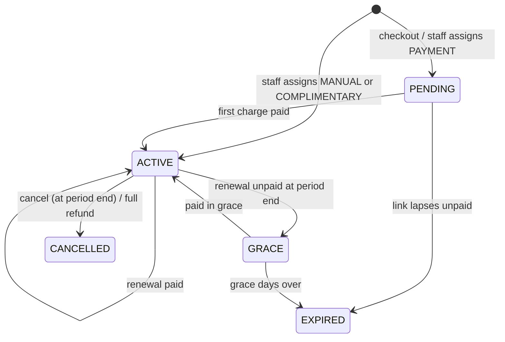
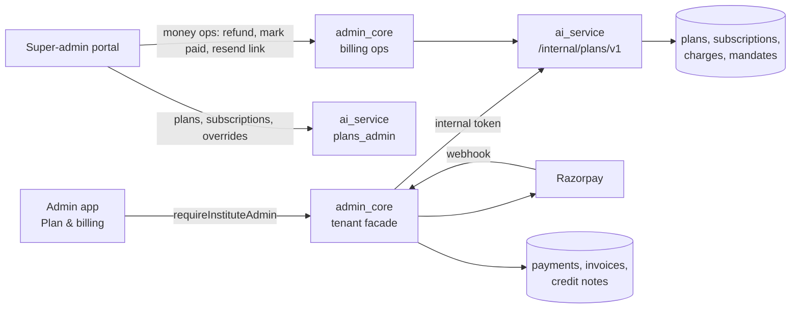

# AI subscription plans

How monthly AI plans work: what a plan is, how the plan decides who pays for each AI use, how an institute subscribes and pays (Razorpay, UPI Autopay, GST invoices), the white-labelled self-serve storefront, and how to operate it all.

Models, credits pricing, usage tracking and limits are in [AI_MODELS_AND_USAGE.md](AI_MODELS_AND_USAGE.md). Step-by-step operations (Razorpay setup, rollout order, incident playbooks) are in the runbook [docs/billing/ai-plan-payments.md](../billing/ai-plan-payments.md).

Last updated 2026-10-16. If a table, setting or path here does not match the code, the code wins; fix this page in the same PR.

Contents

1. [The idea](#1-the-idea)
2. [Concepts](#2-concepts)
3. [Data model](#3-data-model)
4. [How the plan decides who pays](#4-how-the-plan-decides-who-pays)
5. [Subscription lifecycle](#5-subscription-lifecycle)
6. [Payments](#6-payments)
7. [GST invoices and credit notes](#7-gst-invoices-and-credit-notes)
8. [White-labelling and the self-serve storefront](#8-white-labelling-and-the-self-serve-storefront)
9. [Which service owns what](#9-which-service-owns-what)
10. [Switches and rollout state](#10-switches-and-rollout-state)
11. [Screens](#11-screens)
12. [Recipes](#12-recipes)
13. [Changes in October 2026](#13-changes-in-october-2026)
14. [Known gaps and open decisions](#14-known-gaps-and-open-decisions)

---

## 1. The idea

Without a plan, every AI use is paid from the institute's credit wallet. A plan is a monthly subscription (for example **AI Pro: ₹5,000 + GST per month**) that changes **who pays** for each AI feature:

| Mode | Who pays | Example |
|---|---|---|
| **Included** | Nobody: the use is free to the institute (within fair-use caps) | Course content, question generation, KB Q&A, admin assistant |
| **Allowance** | The plan's monthly credit allowance (for example 2,000 credits); once used up, the wallet | Images, KB ingest, transcription, AI video |
| **Charged** | The wallet, exactly as without a plan | AI calling, telephony, premium TTS, engagement messages |

Principles:

- **The plan decides who pays; the existing pricing decides how much.** The credit price of every use is computed exactly as without a plan (see the models doc). The plan only moves the bill from the wallet to the allowance, or to nobody.
- **Every use is still tracked.** An included use writes a usage event with its full list price and model, so we see real usage and real cost per institute even when the institute pays nothing.
- **AI calling and telephony are never included.** This is locked in data and hard-coded in the engine.
- **Safe by default.** Every failure falls back to "charged from the wallet", which is today's behaviour. A plan can never make a use free by accident, and never fails the use.
- **Prepaid.** A paid subscription gives its benefits only for a period whose charge is paid.

---

## 2. Concepts

| Term | Meaning |
|---|---|
| **Billing feature** | A billing category (`ai_billing_feature`), for example `content_generation`, `image_generation`, `ai_calling`. Every metering use case maps to one through `ai_use_case_catalog.billing_feature_key`. 24 features. |
| **Eligibility** | What a feature may be in any plan: INCLUDABLE, ALLOWANCE_ONLY (may use the allowance, never free) or ALWAYS_CHARGED. |
| **Plan / version** | A plan (`ai_pro`) has numbered versions. A version holds the price, period, allowance and items. A **published version is frozen**; editing a plan means a new version. |
| **Item** | One feature's rule inside a version: mode, fair-use caps, roles, model policy. **No item = charged.** |
| **Subscription** | An institute on one plan version: status, source (how it is paid), enforcement (SHADOW or LIVE), optional price override. |
| **Period** | One billing month of a subscription, with its allowance and payment status. |
| **Override ("custom deal")** | A per-subscription change to one feature's item (mode or caps), for a negotiated deal. |
| **Charge** | An amount owed for a period or an upgrade, collected by payment link or autopay. |
| **Fair-use cap** | A limit on included use per period: institute units, institute credits, institute USD cost, user units or user credits. Past the cap, the use is charged (never refused). |

---

## 3. Data model

All tables are in the admin_core database. Plan tables come from **V588** (`V588__ai_subscription_plans.sql`); payment tables from **V590** (`V590__ai_plan_payments_storefront.sql`), on top of the platform payment and invoice tables from V240–V242. Enum-like columns are validated in code (`ai_service/app/services/metering/plan_models.py`, `billing_models.py`).

### 3.1 Plans

| Table | Key columns |
|---|---|
| `ai_billing_feature` | `feature_key`, `eligibility`, `locked` (eligibility changes need an unlock reason; `ai_calling` and `telephony` can never change), `tenant_label` |
| `ai_plan` | `plan_key`, `name`, `description`, `is_active`; storefront fields `listed`, `tagline`, `highlights`, `badge`, `sort_order`, `audience_mode` (ALL / ALLOWLIST / SEGMENT) |
| `ai_plan_version` | `version_no`, `status` DRAFT → PUBLISHED → RETIRED, `currency` (INR), `price_minor` (paise per period), `is_tax_inclusive`, `sac_code` (998315), `period_months`, `allowance_credits` (no rollover), `internal_cost_cap_usd` (never shown to tenants), `grace_days` (7), `grace_behaviour` (CHARGED by default: no benefits while unpaid) |
| `ai_plan_item` | `mode` INCLUDED / ALLOWANCE / CHARGED; `roles_included` (NULL = all role classes); `model_policy` DEFAULT_CHAIN / ALLOWLIST / MAX_PRICE / ANY; caps `inst_units_cap`, `inst_credits_cap`, `inst_cost_usd_cap`, `user_units_cap`, `user_credits_cap`; `user_cap_basis` ACTOR (the user who ran it) or SUBJECT (the learner it was about); `display_cap_text` |

**Freeze triggers** (Postgres): a non-DRAFT version can only change status (PUBLISHED → RETIRED); its items cannot be inserted, changed or deleted.

### 3.2 Subscriptions

| Table | Key columns |
|---|---|
| `institute_ai_subscription` | `status` PENDING / SCHEDULED / TRIAL / ACTIVE / GRACE / EXPIRED / CANCELLED; `source` MANUAL / COMPLIMENTARY / PAYMENT; `enforcement` SHADOW / LIVE; `anchor_at`, `start_at`, `end_at`, `period_months`, `auto_renew`, `grace_days`, `cancel_at_period_end`, `pending_plan_version_id` (a downgrade waiting for renewal), `price_override_minor`. At most one live (TRIAL/ACTIVE/GRACE) and one PENDING row per institute. |
| `ai_subscription_period` | `period_start`, `period_end`, `plan_version_id`, `price_minor_snapshot`, `allowance_credits`, `allowance_used`, `payment_status` DUE / PAID / COMPLIMENTARY / WAIVED / REFUNDED |
| `ai_subscription_override` | One active row per (subscription, feature); NULL fields inherit from the item; `reason` required |
| `ai_subscription_event` | Audit history of every change: type, before/after JSON, actor, reason |
| `ai_usage_counter` | Fair-use counters for the period (keys `PLAN:|F:<feature>` and `…|U:<user>`), shared with usage limits |

### 3.3 Payments and documents

| Table | Key columns |
|---|---|
| `ai_subscription_charge` | `kind` PERIOD / UPGRADE; `status` DUE → LINK_SENT / DEBIT_SCHEDULED → PAID (or FAILED / VOID / REFUNDED / PARTIALLY_REFUNDED); service window; `base_minor`, `tax_minor`, `total_minor`; `place_of_supply`, `tax_head`; link id/url/expiry; mandate and debit fields; `next_attempt_at`; `period_id` (set when paid). INR only; total = base + tax. |
| `ai_subscription_mandate` | Autopay: Razorpay customer and token, method UPI / CARD / EMANDATE, `max_amount_minor`, status PENDING → ACTIVE (or REJECTED / PAUSED / CANCELLED / EXPIRED). One usable mandate per subscription. |
| `platform_payment`, `platform_payment_item` | One row per Razorpay order or link on the platform account, with the buyer and tax snapshot, `brand_mode`, `disposition` (NORMAL / DUPLICATE / LATE), refund totals. Items are `CREDIT_PACK` or `AI_SUBSCRIPTION`. |
| `platform_billing_profile` | The institute's GST identity: legal name, GSTIN, state, address, billing email |
| `platform_invoice` (+ line items), `platform_credit_note` | Tax invoices and credit notes, with supplier/buyer/tax snapshots, service period and brand mode |
| `platform_document_sequence` | Gap-free numbering per series and financial year |
| `ai_storefront_institute`, `ai_storefront_audience`, `ai_institute_segment` | Who can see the storefront and which plans (section 8) |

---

## 4. How the plan decides who pays

### 4.1 One decision-maker

Every AI charge already passes through `CreditService.deduct_credits` in ai_service (Java services reach it through `CreditClient`). When an institute has a live plan, it calls `_deduct_credits_with_plan`, which asks the engine (`ai_service/app/services/metering/plans.py`, wired by `plan_wiring.py`) for a decision, then applies it:

| Decision | Wallet | Ledger row | Usage event |
|---|---|---|---|
| INCLUDED | unchanged | none | `billing_mode = INCLUDED`, `credits_charged = 0`, full `list_credits` |
| ALLOWANCE | unchanged | none | `ALLOWANCE`; the period's `allowance_used` grows by the list price |
| SPLIT | pays the part the allowance could not | wallet part only | `SPLIT` |
| CHARGED | pays the list price | as today | `CHARGED`, with the reason |

If the event for a plan-covered use cannot be written, the use is charged to the wallet instead, so nothing is ever free and unrecorded.

### 4.2 Decision order

1. No live subscription → **CHARGED** (`NO_SUBSCRIPTION`). Also charged if the subscription has not started, has ended, is unpaid (a PAYMENT subscription without a paid period), or is in grace with `grace_behaviour = CHARGED`.
2. Global switch `billing.plans.enabled` off → **CHARGED** (`PLANS_OFF`), **except** a LIVE subscription with source PAYMENT, which keeps its plan: an institute that paid always gets what it paid for.
3. Feature is ALWAYS_CHARGED, unknown or inactive → **CHARGED**. This beats any item.
4. Merge the active override (if any) over the item. No item → **CHARGED** (`NOT_IN_PLAN`); item mode CHARGED → `PLAN_CHARGED`.
5. **INCLUDED** item on an INCLUDABLE feature, checked in order:
   - the actor's role class is in `roles_included` (else `ROLE_NOT_INCLUDED`);
   - the model passes the model policy (else `MODEL_NOT_INCLUDED`);
   - every fair-use scope has room, taken atomically with a guarded counter update (else `OVER_CAP`).

   All pass → INCLUDED. An included item never falls back to the allowance.
6. **ALLOWANCE** item (or INCLUDED on an ALLOWANCE_ONLY feature): take from `allowance_used` under a row lock. Full → ALLOWANCE; partial → SPLIT; empty → CHARGED (`ALLOWANCE_EXHAUSTED`).

Every reason is stored in the usage event's context (`plan_reason`, `plan_feature`), so a support question ("why was this charged?") can be answered from History.

### 4.3 Model policy

- `DEFAULT_CHAIN` (default for included items): the use is included only if it ran on the **primary model of the feature's default chain** (see the models doc). A model the user or institute picked themselves is charged. This stops "free" use of expensive models.
- `ALLOWLIST`: the model must be in `model_allowlist`.
- `MAX_PRICE`: the model's output price per 1M tokens must be at or under `max_output_price_per_1m`.
- `ANY`: any model.

A live charge on a model outside the chain leaves a per-period "strike" for that user and feature, so later pre-checks do not promise coverage.

### 4.4 SHADOW mode

A subscription with `enforcement = SHADOW` is evaluated on every use, but nothing is reserved or counted and the institute is charged exactly as today. The event records what LIVE would have done in `shadow_billing_mode`. Use it to trial a plan on real traffic before switching to LIVE.

### 4.5 Refunds of plan-covered uses

When a charged batch is refunded (for example a failed AI video), the wallet gets back only the part it paid, the allowance part goes back to the period, and an included part is credited nowhere.

### 4.6 Pre-checks

`precheck` is read-only: it tells a feature, before the work, whether the use would be covered (LIVE INCLUDED, or ALLOWANCE with enough left). Balance and limit checks still run for anything not covered.

### 4.7 Simulate and P&L

- **Simulate** (`POST /super-admin/v1/plans/simulate`): replays up to 90 days of an institute's real usage events through a plan version, as if LIVE. Read-only. Use it to price a plan for an institute before offering it.
- **P&L** (`GET /super-admin/v1/plans/pnl`): per period, price, payment status, included and allowance credits, real or estimated vendor cost, and margin in INR (`billing.inr_per_usd`).

---

## 5. Subscription lifecycle

### 5.1 How a subscription starts

| Source | Who | Payment |
|---|---|---|
| `PAYMENT`, self-serve | Institute admin, Plan & billing storefront | Checkout creates a PENDING subscription and a DUE first charge; the admin pays by payment link, or sets up UPI Autopay and pays the first charge through it |
| `PAYMENT`, sales-led | Super admin, portal "Assign" | Same PENDING subscription and charge; the portal's **Send link** creates the Razorpay link immediately and emails it. A staff price override (`price_override_minor`) is allowed here, never in self-serve. |
| `MANUAL` / `COMPLIMENTARY` | Super admin | No charge; periods are COMPLIMENTARY. For deals paid outside Razorpay, or trials. |

A PAYMENT subscription becomes ACTIVE **when the first charge is paid**, and the billing anchor is the payment time (so the month starts when they paid, not when the link was sent).

### 5.2 Renewal

- The hourly **roll** (admin_core `AiPlansRollJob`, minute 07 UTC → ai_service `/internal/plans/v1/roll`) opens new periods and creates the renewal charge **7 days before** the period ends.
- The hourly **billing job** (admin_core `AiSubscriptionBillingJob`, minute 37 UTC) collects it: by autopay when an active mandate exists and the amount is within the ₹15,000 UPI Autopay limit, otherwise by a payment link valid until the end of grace. Reminders go at T−3, T−0 and once in grace.
- Unpaid at the period end → GRACE (benefits pause with the default `grace_behaviour = CHARGED`; AI use falls back to the wallet) → EXPIRED after `grace_days`.
- Paying late does not move the renewal date.

### 5.3 Changing plans

- **Upgrade: immediately, pro-rata.** Net due = new price × days left / period days − old price × days left / period days (IST days, floor 0). An UPGRADE charge with its own invoice; the allowance grows pro-rata; the plan switches when the charge is paid. An upgrade costing under ₹1 applies at once.
- **Downgrade: at the period end** (`pending_plan_version_id`).
- **Cancel: at the period end** (`cancel_at_period_end`); the admin can resume before then. Cancelling a pending checkout ends it at once and cancels its mandate.
- **New plan versions:** existing subscribers stay on their version; they move at renewal only if the new version says so (`migrate_existing_at_renewal`).

### 5.4 Refunds

No self-serve refunds. Staff refund from the portal (Billing card): admin_core asks Razorpay for the refund, and when Razorpay confirms it (`refund.processed`) a **credit note** is issued against the invoice. A full refund of the current period marks the period REFUNDED and cancels the subscription. Staff can also issue a credit note without a refund (for example after an offline settlement).

---

## 6. Payments

All money moves through the **platform** Razorpay account (Vacademy's own, not the institute's) and admin_core.

### 6.1 Payment links

Each charge gets one hosted Razorpay **Payment Link** (`POST /payment_links`), with Razorpay's own SMS/email notifications turned off (we send our own email), the checkout name set by brand mode, and an expiry:

| Charge | Link valid for |
|---|---|
| First purchase | 48 hours |
| Upgrade | 2 hours (quote valid 1 hour) |
| Renewal | until the end of grace |

There is never more than one payable link per charge: creating a new one cancels the old one first (and if the old one turns out to be paid, that payment is used).

### 6.2 UPI Autopay and card mandates (Charge at Will)

Recurring payments use Razorpay **Charge at Will** with a saved token, not the Razorpay Subscriptions product:

1. The admin sets up autopay: admin_core creates a Razorpay customer and a registration link (UPI or card).
2. Razorpay confirms the token (`token.confirmed` webhook) → mandate ACTIVE.
3. For each renewal: the token is checked at Razorpay first; the **pre-debit notice** email goes out from 72 hours before the period start (and at least 24 hours before the debit); the debit is created 40 hours before the start (`POST /orders` + `POST /payments/create/recurring`).
4. A failed debit falls back to a payment link immediately.

Limits: UPI Autopay up to **₹15,000** per debit without extra authentication; above that, renewals go by link. A card mandate cannot pay the first charge (it registers with a ₹1 authorisation that is refunded), so the first payment is by link.

Switch: `billing.autopay.enabled` (also needs payments on).

### 6.3 Webhook

One endpoint for the platform account: `/admin-core-service/payments/webhook/callback/razorpay-platform`. Every event is stored, the signature is verified, and the event is routed by `notes.payment_type` (AI_CREDIT_PACK or AI_SUBSCRIPTION).

| Event | Action |
|---|---|
| `payment.captured`, `order.paid` | Fulfil. The paid amount must equal the server-side snapshot. ai_service marks the charge PAID first (`/charges/{id}/paid`, row-locked; the amount must equal `total_minor`); only after that succeeds is `platform_payment` marked PAID, then the invoice is issued and emailed. |
| `payment.failed` | Mark failed; a failed autopay debit falls back to a link |
| `refund.processed` | Credit note, and ai_service records the refund |
| `refund.created` / `refund.failed` | Record pending / clear it and alert |
| `token.confirmed`, `token.rejected`, `token.paused`, `token.cancelled` | Update the mandate (older events are ignored) |

Everything is idempotent: Razorpay usually sends several events for one payment (for example `payment.captured` and `order.paid`); only the first one acts. A failure before PAID returns HTTP 500 so Razorpay retries. A duplicate or late payment is not an error: it is recorded with a disposition (DUPLICATE / LATE) and refunded automatically.

### 6.4 Jobs (admin_core, UTC, one replica via ShedLock)

| Job | When | What | Switch |
|---|---|---|---|
| `AiPlansRollJob` | minute 07 hourly | Open periods, create renewal charges, move to GRACE / EXPIRED | `billing.plans.roll.enabled` (default on) |
| `AiSubscriptionBillingJob` | minute 37 hourly | Create links (renewals and staff-queued first charges), autopay notices and debits, reminders, expire stale checkouts, reconcile lost webhooks and missing invoices | `billing.subscriptions.payments.enabled` |
| `CreditPackReconcileJob` | minute 47 hourly | Reconcile credit-pack links | `billing.packs.reconcile.enabled` |

---

## 7. GST invoices and credit notes

- **Supplier:** the legal entity Vidyayatan Technologies LLP (from `platform_payment_config`).
- **SAC:** 998315 for subscriptions (every new plan version gets it).
- **Tax:** 18% GST. Buyer in the supplier's state → CGST 9% + SGST 9%; another state → IGST 18%. The buyer's state comes from their GSTIN, or from the state they pick; it is required for subscriptions. Place of supply = buyer state. Tax is rounded half-up; for an odd paisa SGST takes the extra. Exports are not supported for subscriptions.
- **B2C buyers** at or above ₹50,000 must give an address.
- **Numbering:** invoices `VT/{FY}/I#####`, credit notes `VT/{FY}/C#####` (14 characters, within the 16 allowed). FY follows Indian time (`2627` = April 2026 – March 2027). Numbers are allocated in the same transaction as the document, so a rollback leaves no gap. Subscriptions require the v2 series (`billing.invoice.series_v2.enabled`); old credit-pack invoices keep `INV-AICRED-…`.
- **When:** the invoice is issued when the payment is confirmed (prepaid), with the service period on it; PDF by `PlatformInvoicePdfService`; emailed to the institute's billing email and visible in the Billing tab.
- **Credit notes** split base and tax in the same ratio as the invoice, never exceed it, and are idempotent per Razorpay refund id.

Open questions for the CA (SAC, series, e-invoicing thresholds) are tracked outside this repository.

---

## 8. White-labelling and the self-serve storefront

### 8.1 Brand mode

Each institute has a brand mode (`BrandModeService`), frozen on every payment:

| Mode | When | What the institute sees |
|---|---|---|
| `VACADEMY` | Default | Vacademy name on the checkout page, emails and documents |
| `NEUTRAL` | The institute's admin portal runs on its own (non-Vacademy) domain, or a super admin forces it | No "Vacademy" in tenant copy: checkout name, email subject and body are brand-free; documents show only the legal supplier name |

A super admin can override the mode per institute. Any lookup error resolves to NEUTRAL (the safe side).

**Billing email sender:** the platform sender (`billing_from_name` / `billing_from_email`, today "Billing · Vacademy") is used for every institute, including NEUTRAL ones (owner decision 2026-10-16: white-labelled admins may receive mail from the Vacademy billing sender). Subject and body stay brand-free for NEUTRAL. If no platform sender is configured, the institute's own brand-free sender is used; failing that, the email is withheld and the document stays in the Billing tab.

### 8.2 Who sees the storefront

The storefront is AI Settings → **Plan & billing** in the institute's own admin app, for admins only. Server-side rules (`StorefrontAccessService`), in order:

1. `billing.storefront.mode`: OFF (nobody), ALLOWLIST, SEGMENTS or ALL;
2. sub-organisations never see it;
3. a per-institute `storefront_enabled = FALSE` always hides it; TRUE allow-lists it;
4. EXCLUDE audience rules always win over INCLUDE.

Each plan also has its own audience (`audience_mode` ALL / ALLOWLIST / SEGMENT, plus audience rows), and must be `listed` with a PUBLISHED version to appear.

### 8.3 What the institute admin can do

See plans and what each includes; check out (billing details → autopay choice → Razorpay); see the current plan, period, renewal date, allowance and fair-use usage; pay an open charge; set up or cancel autopay; upgrade, downgrade, cancel or resume; download invoices and credit notes. The price shown is the institute's own price (including a staff price override).

---

## 9. Which service owns what

| Concern | ai_service | admin_core |
|---|---|---|
| Plan catalogue, versions, items, subscriptions, overrides, simulate, P&L, listing, audience | `routers/plans_admin.py` (`/super-admin/v1/plans`, platform staff; every write needs a reason) | — |
| Subscription and charge state: quote, checkout, change, paid, refunded, void, waive, storefront catalogue | `routers/plans_billing_internal.py` (`/internal/plans/v1`, internal token) | — |
| Roll | `routers/plans_internal.py` | `AiPlansRollJob` |
| Tenant plan view (what is included, usage) | `routers/credits_plan.py` | — |
| Engine | `services/metering/plans.py`, `plan_wiring.py`, `plan_models.py`, `billing_models.py` | — |
| Tenant storefront and billing API | — | `AiPlansStorefrontController` (`/admin-core-service/ai-plans/v1/**`; institute admins only; 404 when the storefront is off) |
| Staff money actions and documents | — | `AiPlansBillingOpsController` (`/super-admin/v1/ai-plans-billing/institutes/{iid}/…`: billing, mark-paid, waive, resend-link, refund, credit note, cancel mandate, PDFs) |
| Razorpay, webhook, GST, invoices, credit notes, PDFs, email, brand mode | — | `RazorpayHttpPlatformGateway`, `PlatformRazorpayWebHookService`, `AiSubscriptionPaymentHandler`, `TaxResolver`, `PlatformInvoiceService`, `PlatformCreditNoteService`, `AiPlansBillingMailer`, `BrandModeService`, `NeutralSender` |

admin_core calls ai_service through `AiPlansInternalClient` (HTTP/1.1, internal service token). ai_service never calls Razorpay; admin_core never decides plan eligibility.

---

## 10. Switches and rollout state

Platform settings (`ai_platform_settings`), editable in the portal's AI settings page:

| Key | Default | Gates | Production, 2026-10-16 |
|---|---|---|---|
| `billing.plans.enabled` | false | The engine for MANUAL / COMPLIMENTARY / SHADOW subscriptions (paid LIVE ones always apply) | true (only one live subscription exists) |
| `billing.plans.roll.enabled` | true | The hourly roll | default |
| `billing.subscriptions.payments.enabled` | false | PAYMENT subscriptions, checkout, links, debits, the billing job | true |
| `billing.autopay.enabled` | false | Mandate setup and debits | false |
| `billing.storefront.mode` | OFF | Tenant storefront (OFF / ALLOWLIST / SEGMENTS / ALL) | ALLOWLIST |
| `billing.invoice.series_v2.enabled` | false | New invoice numbering; required for subscriptions | true |
| `billing.buyer_state.required` | false | Buyer state for credit packs (subscriptions always require it) | default |
| `billing.packs.reconcile.enabled` | false | Hourly credit-pack reconcile | default |
| `billing.inr_per_usd` | 86 | P&L and simulate only | default |

**State on 2026-10-16:** AI Pro v1 (₹5,000 + GST per month, 2,000 allowance credits) is published and listed for an allow-listed pilot. The first live payment (a ₹10 staff price override on an internal institute) went end to end: link → payment → subscription ACTIVE → period PAID → invoice `VT/2627/I00001` with CGST + SGST → email from the platform sender. Included and allowance uses were then verified on that subscription (wallet unchanged; allowance used grew by the list price).

---

## 11. Screens

### Super-admin portal (vacademy-health-check)

| Screen | What it does |
|---|---|
| **AI plans** (`/ai-plans`, plan detail) | Plans, versions and items (version editor), publish / retire, storefront listing (tagline, highlights, badge), plan audience |
| **Simulate** (`/ai-plans/simulate`) and **P&L** (`/ai-plans/pnl`) | Section 4.7 |
| **Storefront** (`/ai-plans/storefront`) | Storefront mode, per-institute switch and brand-mode override, segments, audience, preview as an institute |
| **AI subscriptions** (`/ai-subscriptions`) and the institute's plan tab | Assign (source MANUAL / COMPLIMENTARY / PAYMENT, price override, "email the payment link now"), subscription panel, **Custom deal (overrides)**, cancel |
| **Billing card** (`BillingTimeline`) | Charges with Send / Resend link (creates the Razorpay link at once and shows it), Paid offline, Waive, Refund, mandate status and cancel, history |
| **Documents** (`BillingDocumentsCard`) | Invoices and credit notes, staff credit note |
| **AI settings** | The switches in section 10 |

### Institute admin app

AI Settings → **Plan & billing** (`frontend-admin-dashboard/src/routes/settings/-components/ai-plan/`): `PlanCatalog`, `PlanCheckoutDialog`, `ManageSubscription`, `AutopayFields`, invoices; `AiPlanSection` is the read-only view of what the plan includes and fair-use usage. The client is `services/ai-plans/storefront.ts`; all amounts come from the server.

In the AI credits panel, History rows show "Included" / "From allowance" for plan-covered uses (see the models doc).

---

## 12. Recipes

Operational detail (Razorpay dashboard, test-mode probe, incidents) is in the [runbook](../billing/ai-plan-payments.md).

### Create or change a plan

1. Portal → AI plans → new plan (or open one) → **new version** (a copy of the latest; published versions cannot be edited).
2. Set price, period, allowance, grace, and an item per feature (mode, caps, roles, model policy). Features without an item are charged.
3. **Simulate** it against a few real institutes; check the margin in P&L terms.
4. Publish. Existing subscribers stay on their version unless the new one migrates them at renewal.
5. To sell it self-serve: set the listing fields, mark it listed, and set its audience.

### Sell a plan to one institute (sales-led)

1. Make sure the institute has a billing profile with its **state** (and GSTIN if registered).
2. Portal → AI subscriptions → **Assign**: plan version, source **Payment**, enforcement Live, optional price override, reason.
3. On the Billing card, **Send link**: the link is created and emailed at once, and shown for copying.
4. When paid, the subscription is ACTIVE and the invoice is emailed. Nothing else to do; renewals are automatic.

### Give a custom deal

Subscription panel → **Custom deal (overrides)** → feature → mode and/or caps → reason. It applies from the next use. Remove it the same way.

### Trial a plan without changing charges

Assign with enforcement **Shadow** (source Manual). The institute is charged as today; usage events show what the plan would have done (`shadow_billing_mode`), and P&L shows the would-be margin. Switch to Live when ready.

### Refund

Billing card → Refund (amount and reason). The credit note is issued when Razorpay confirms the refund. Use **Paid offline** for bank transfers and **Waive** to forgive a charge.

---

## 13. Changes in October 2026

| Date | Commit | Change |
|---|---|---|
| 10-16 | `21e628bb0d` | AI subscription plans v1: V588, versioned plans, INCLUDED / ALLOWANCE / CHARGED, SHADOW → LIVE, portal plans/subscriptions/simulate/P&L (portal `3b71119`) |
| 10-16 | `b33f3d8ce9` | Credit-pack endpoints restricted to institute admins / staff |
| 10-16 | `e581167c49` | Payments: V590, Razorpay links and UPI Autopay, GST invoices and credit notes, brand-aware storefront (portal `8f2e94c`) |
| 10-16 | `a306dd2c02` | Autopay: check the token at Razorpay before the pre-debit notice |
| 10-16 | `169a1c1510` | White-labelled admins get billing mail from the platform sender |
| 10-16 | `c3ff768e33` | The billing job sends staff-queued first-purchase links (portal `d15843b`: Send link creates the link immediately) |
| 10-16 | `6d3ada7272` | Plan & billing shows the institute's own price when it has a price override |
| 10-16 | this change | The roll job's pre-check includes PENDING checkouts, so an unpaid checkout is expired even when it is the only open subscription |

---

## 14. Known gaps and open decisions

- **Autopay** is built but switched off; one UPI Autopay test on the pilot institute is the next step.
- **Pilot:** one internal institute so far; a white-labelled (NEUTRAL) pilot is still to be chosen.
- **`billing.plans.enabled`** is on in production; whether to keep it on generally (it only matters for MANUAL / COMPLIMENTARY / SHADOW subscriptions) is an owner decision.
- **CA review** of the SAC code and invoice series is pending.
- **Over-cap BLOCK** exists in the schema but the API only allows CHARGE in this release: a plan never refuses work.
- Subscriptions are INR-only; exports are not supported.
