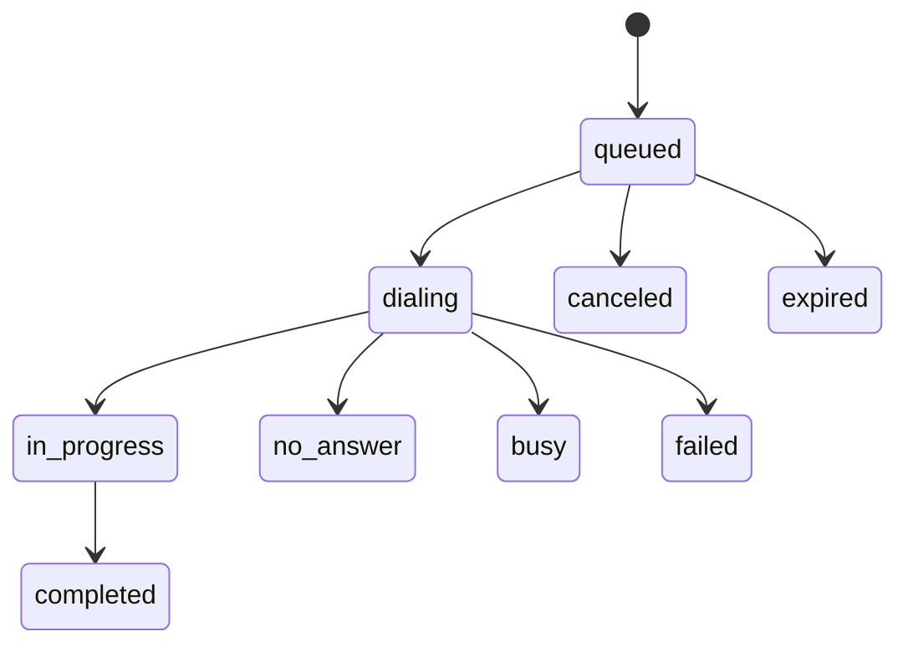

A **call** is one attempt to reach one phone number with one agent. You create it with `POST /v1/calls` (or many at once with [batches](/guides/bulk-calling)), and it has an id like `call_6f1d2c9a8b7e4f3a2d1c0b9a` that you keep.

## Statuses



| Status | Meaning | Final |
|---|---|---|
| `queued` | Waiting for a free line, for calling hours, or for a limit to clear. `status_reason` says which. | No |
| `dialing` | Being placed; the phone is ringing. | No |
| `in_progress` | The contact answered and is talking to the agent. | No |
| `completed` | The call connected and has ended. The outcome is attached. | Yes |
| `no_answer` | Rang out, or was not picked up. | Yes |
| `busy` | The line was busy or the call was rejected. | Yes |
| `failed` | The call could not be placed, or no result came back for it within 2 hours. `status_reason` says why. | Yes |
| `canceled` | Canceled before it was dialled: by you, from the dashboard queue, by a limit, or because its agent was turned off. | Yes |
| `expired` | No line became free before the call's time in the queue ran out (48 hours). | Yes |

A call in a **final** status never changes again, and its webhook is sent exactly once when it gets there.

<Note>
A call shows `completed` as soon as it ends, but it becomes **final** (and its webhook is sent) once the outcome and the recording are attached, usually within a minute or two of hanging up. If either never arrives, the call is finalised 10 minutes after it ended, with what is available. Until then, `GET /v1/calls/{id}` may show `completed` with `outcome: null`.
</Note>

## Reading a call

```bash
curl https://api.telleo.ai/v1/calls/call_6f1d2c9a8b7e4f3a2d1c0b9a -H "X-API-Key: $TELLEO_API_KEY"
```

<ResponseField name="id" type="string">The call id.</ResponseField>
<ResponseField name="status" type="string">One of the statuses above.</ResponseField>
<ResponseField name="status_reason" type="string">Why a call is waiting, was canceled or failed, in plain words. Only present when there is a reason.</ResponseField>
<ResponseField name="scheduled_for" type="string">While `queued`: the earliest time it will be tried again, when it is held (outside calling hours, recall gap, daily limit).</ResponseField>
<ResponseField name="agent_id, phone_number, contact, variables, metadata" type="object">What you sent, echoed back. `phone_number` is normalised to E.164.</ResponseField>
<ResponseField name="batch_id" type="string | null">The batch it belongs to, if any.</ResponseField>
<ResponseField name="test" type="boolean">`true` for a [test call](/concepts/test-mode).</ResponseField>
<ResponseField name="duration_seconds" type="integer | null">Length of the conversation.</ResponseField>
<ResponseField name="created_at, dialed_at, ended_at" type="string | null">ISO-8601 UTC timestamps. `ended_at` is set once the call is final: when the call itself ended, or, for a call that was never dialled, when it was canceled, expired or failed.</ResponseField>
<ResponseField name="cost" type="object | null">`{credits, billed}`: what the call cost. See [Credits and usage](/platform/credits-and-usage#cost-of-one-call).</ResponseField>
<ResponseField name="recording_url" type="string | null">A temporary link to the recording, valid until `recording_expires_at` (24 hours). Read the call again for a fresh link.</ResponseField>
<ResponseField name="outcome" type="object | null">What the agent learned. See [Outcomes](/concepts/outcomes).</ResponseField>

## Canceling

`POST /v1/calls/{id}/cancel` cancels a call that is still `queued`. Once it is `dialing` it cannot be stopped; the request returns `409 call_not_cancelable` with the current status.

## Finding calls

`GET /v1/calls` lists calls newest first. Filter with:

- `external_id`: every call for one of your records (the `contact.external_id` you sent).
- `batch_id`: every call in a batch.
- `created_after`: calls created after an ISO-8601 time.

See [Pagination](/platform/pagination).

## One call per number at a time

A number that already has a call **waiting in the queue** cannot get a second one: the request fails with `409 call_already_queued`, and `details.call_id` is the call already waiting. Once that call has been dialled, you can queue another, subject to the [limits](/concepts/queue-and-limits).
