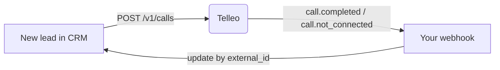

This is the pattern almost every integration follows, whether your CRM is home-grown, a database behind your website, or a hosted CRM with webhooks and an API.



## 1. Trigger a call when a lead arrives

Whatever creates a lead (a form, an import, an ad integration) also calls Telleo. Use the CRM record id twice: as `contact.external_id`, to find the record again, and as the `Idempotency-Key`, so a retried job never calls the lead twice.

<CodeGroup>

```javascript Node.js
async function callNewLead(lead) {
  const res = await fetch("https://api.telleo.ai/v1/calls", {
    method: "POST",
    headers: {
      "X-API-Key": process.env.TELLEO_API_KEY,
      "Content-Type": "application/json",
      "Idempotency-Key": `lead-${lead.id}`,
    },
    body: JSON.stringify({
      agent_id: process.env.TELLEO_AGENT_ID,
      phone_number: lead.phone,            // +91XXXXXXXXXX
      contact: { name: lead.firstName, email: lead.email, external_id: String(lead.id) },
      variables: { course: lead.courseName, city: lead.city },
      metadata: { owner_id: lead.ownerId },
    }),
  });
  const body = await res.json();
  if (res.status === 201 || res.status === 200) {
    await db.leads.update(lead.id, { telleoCallId: body.id, callStatus: body.status });
  } else if (body.error?.code === "call_already_queued") {
    // A call for this number is already waiting: nothing to do.
  } else {
    throw new Error(`${res.status} ${body.error?.code}: ${body.error?.message}`);
  }
}
```

```python Python
import os, requests

def call_new_lead(lead):
    r = requests.post(
        "https://api.telleo.ai/v1/calls",
        headers={
            "X-API-Key": os.environ["TELLEO_API_KEY"],
            "Idempotency-Key": f"lead-{lead.id}",
        },
        json={
            "agent_id": os.environ["TELLEO_AGENT_ID"],
            "phone_number": lead.phone,
            "contact": {"name": lead.first_name, "email": lead.email, "external_id": str(lead.id)},
            "variables": {"course": lead.course_name, "city": lead.city},
            "metadata": {"owner_id": lead.owner_id},
        },
        timeout=15,
    )
    body = r.json()
    if r.status_code in (200, 201):
        lead.update(telleo_call_id=body["id"], call_status=body["status"])
    elif body["error"]["code"] != "call_already_queued":
        raise RuntimeError(f'{r.status_code} {body["error"]["code"]}: {body["error"]["message"]}')
```

</CodeGroup>

**Speed matters.** A lead called within minutes of their enquiry is far more likely to pick up and to remember why. Trigger the call from the same request that saves the lead, or from a job that runs within seconds, not from a nightly sync.

## 2. Write the result back

Your [webhook](/webhooks/overview) receives `call.completed` or `call.not_connected` for every call. Find the record by `data.contact.external_id`, then store what you need:

| Telleo field | Typical CRM field |
|---|---|
| `outcome.disposition` | Lead stage or status |
| `outcome.lead_rating` (1–10) | Lead score |
| `outcome.summary` | A note or activity on the record |
| `outcome.answers` | Custom fields (course, budget, timeline…) |
| `outcome.meeting.at` | Appointment / callback date |
| `outcome.follow_up`, `follow_up_note` | Task for a counsellor or sales rep |
| `recording_url` | Download and attach, or link (the link expires in 24 hours) |
| `status` on `call.not_connected` | Call attempt log; schedule a retry |

```javascript
function mapDisposition(d) {
  switch (d) {
    case "Interested": return "Qualified";
    case "Not interested": return "Lost";
    case "Call back later": return "Follow-up";
    default: return "Contacted";
  }
}
```

Use the disposition names configured on **your** agent; they appear in the dashboard and in every outcome.

## 3. Retry calls that did not connect

Telleo does not redial on its own. When you get `call.not_connected` with `no_answer` or `busy`, decide on your side whether to try again, and create a new call later, for example 2 hours later, then the next day. Use a new `Idempotency-Key` for each attempt (`lead-8812-attempt-2`).

[Per-number limits](/concepts/queue-and-limits) still apply, so a bug that retries in a loop cannot ring someone all day.

## 4. Stay in sync

Webhooks are the main path. As a safety net, run a small job every few hours that lists recent calls and fills any gaps:

```bash
curl "https://api.telleo.ai/v1/calls?created_after=2026-10-13T00:00:00Z&limit=100" \
  -H "X-API-Key: $TELLEO_API_KEY"
```

## Checklist

- [ ] The key lives on your server, never in the browser.
- [ ] Every call carries `external_id` and an `Idempotency-Key`.
- [ ] The webhook verifies `Telleo-Signature` and answers 2xx quickly.
- [ ] Repeated event ids are ignored.
- [ ] `call.not_connected` is handled, not only `call.completed`.
