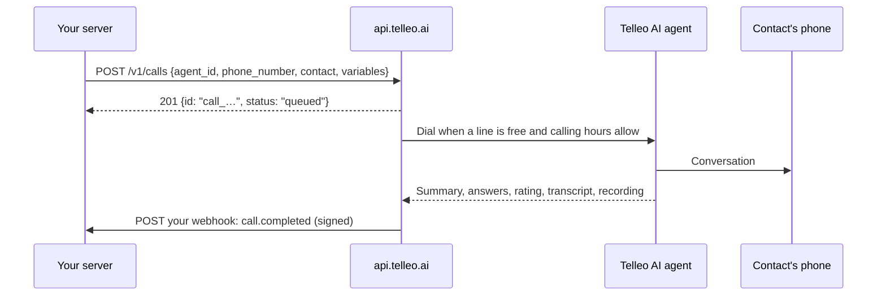

Telleo's AI agents call your leads and customers in Hindi, English and Hinglish: they qualify, answer questions, take callbacks and book appointments. The Telleo API lets your own systems decide **who** gets called and **when**, and sends the result of every call back to you.

Typical uses:

- **Speed-to-lead.** Your CRM or website form calls a new lead within seconds of the enquiry.
- **Reminders and confirmations.** Your booking system calls before an appointment, a class or a payment date.
- **Re-engagement.** A nightly job calls the contacts who went quiet, in one batch.
- **Feedback.** Your support tool calls a customer after a ticket closes and records what they said.

## How it works

1. You **start a call** with the agent to use, the phone number, the contact's name and any details the agent should mention (`variables`).
2. Telleo **queues** it and dials as soon as one of your lines is free and within your calling hours.
3. When the call is over, Telleo **posts the outcome** to your webhook: disposition, summary, answers to the agent's questions, interest score, callback request, transcript and recording link.

You never need to keep a connection open or poll, but you can: `GET /v1/calls/{id}` always returns the latest state.

## What you need

<CardGroup cols={2}>
  <Card title="An agent" icon="user-headset">
    Created in the dashboard under **CRM → Calling → AI Agents**. It holds the voice, language, script and the questions to ask.
  </Card>
  <Card title="An API key" icon="key">
    Created by an admin in the dashboard ([how](/getting-api-access)). It stays on your server.
  </Card>
  <Card title="A webhook endpoint" icon="webhook">
    An HTTPS URL on your side that receives call results. Optional, but recommended.
  </Card>
  <Card title="Calling credits" icon="indian-rupee-sign">
    Calls are billed per connected minute at your plan's rate. Test calls are free.
  </Card>
</CardGroup>

## Next steps

<CardGroup cols={3}>
  <Card title="Quickstart" icon="rocket" href="/quickstart">
    Place your first call in five minutes.
  </Card>
  <Card title="Connect your CRM" icon="plug" href="/guides/crm-integration">
    The pattern most integrations follow.
  </Card>
  <Card title="API reference" icon="square-terminal" href="/api-reference/introduction">
    Every endpoint and field.
  </Card>
</CardGroup>
