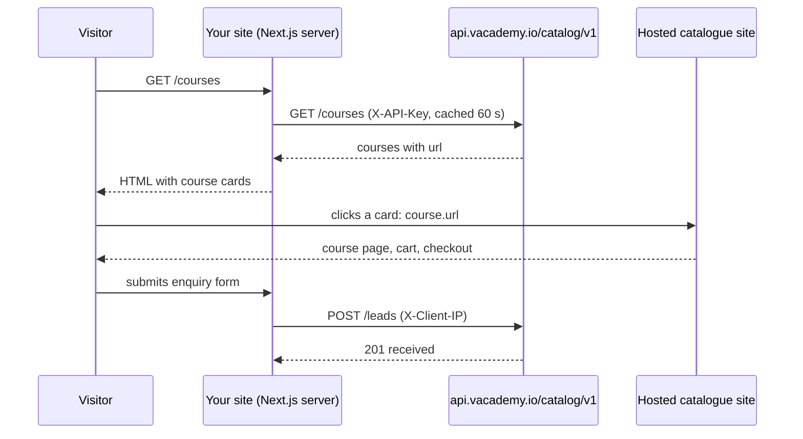

The Catalogue API gives an institute's own website (typically Next.js, rendered on the server for SEO) read access to what the institute has published on Vacademy:

- **Courses**: title, card text, image, formats, languages, price and availability, every version (level, batch, language edition), plus a detail view with descriptions, FAQs, authors, `seo` metadata and schema.org `structured_data`.
- **Streams and categories**: the subject areas the hosted catalogue groups courses into.
- **Learning paths**: ordered sequences of courses.
- **Enquiries**: `POST /leads` files a visitor's enquiry into the institute's CRM, like the hosted catalogue's own form.

Enrolment, cart and checkout stay on the institute's **hosted catalogue site** (for example `learning.brahmvarchas.org`). Every course in the API carries a `url` to its page there.

## How it fits together



The API reads the same data, with the same rules, as the hosted catalogue site, so the two never disagree: a course hidden there is absent here, a price hidden there is `null` here, and a stream has the same courses in both.

## Base URL

```
https://api.vacademy.io/catalog/v1
```

Every request carries the institute's publishable key in `X-API-Key` (or `Authorization: Bearer`). Keys start with `vak_pub_`. See [Keys and websites](/keys-and-websites).

## Endpoints

| | |
|---|---|
| `GET /site` | Institute, course page address, languages, formats, currency |
| `GET /courses` | Search, filter, sort and page courses |
| `GET /courses/{id}` | One course, with `seo` and `structured_data` |
| `GET /courses/{id}/outline` | Subject, module and chapter titles |
| `GET /streams` | Streams and their categories |
| `GET /learning-paths` | Learning paths |
| `GET /learning-paths/{code}` | One path and its courses |
| `GET /sitemap` | Every course page, for sitemaps |
| `POST /leads` | Send an enquiry into the CRM |

## Next steps

<CardGroup cols={3}>
  <Card title="Quickstart" icon="rocket" href="/quickstart">
    A Next.js App Router course grid and course page, with SSR and JSON-LD.
  </Card>
  <Card title="Keys and websites" icon="key" href="/keys-and-websites">
    Create a key and verify your domain.
  </Card>
  <Card title="API reference" icon="square-terminal" href="/api-reference/introduction">
    Every endpoint and field.
  </Card>
</CardGroup>
