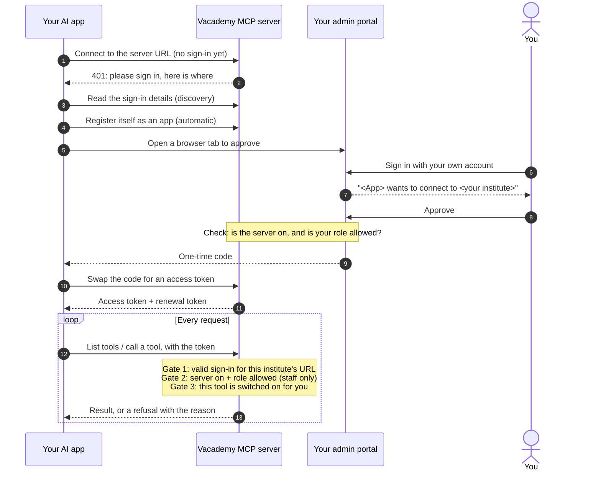

Vacademy MCP is a server that your AI app talks to. Your AI app asks it what tools exist, then calls those tools to read or change your institute's data. Every request is checked against your institute's settings before anything runs.

## The server URL

Each institute has its own server URL. It looks like this:

```text
https://<your backend>/ai-service/mcp/i/<institute_id>
```

You never need to build it yourself. An admin copies it from **Settings → MCP Server → Connect your AI app** in your admin portal.

The URL carries your institute. That is why sign-in lands on your institute's own admin portal, with your brand, and why a connection made with it works only for that institute. See [Your institute's server URL](/mcp/oauth/institute-server-url).

## Connecting, in four steps

1. Paste the server URL into your AI app.
2. A tab opens on your admin portal.
3. Sign in and click **Approve**.
4. Ask your question.

<Frame caption="The Connect an AI app page on your admin portal: which app is asking, for which institute, with Approve and Deny.">
  
</Frame>

<Accordion title="The full sign-in flow (technical)">



</Accordion>

A few details that matter:

- **You approve on your own portal.** The approval page shows which app is asking and which institute it wants. Approve within 15 minutes, or start again from the AI app.
- **You must belong to the institute.** If you are signed in to a different institute, the page refuses and asks you to sign in to the right one.
- **The app never sees your password.** It gets its own token. The token only works on this server URL.
- **Most apps register themselves.** Claude, ChatGPT, Cursor, Claude Code and VS Code do this automatically. A few apps ask for a client ID instead. Your institute has one ready. See [Other apps](/mcp/connect/other-apps).

## The three gates

Every time the AI app lists tools or calls one, the server checks three things from scratch.

<Steps>
  <Step title="Gate 1: a valid sign-in">
    The request carries a token this server issued to one person for one institute. The token must match the server URL it is used on. Tokens expire, and the AI app renews them in the background.
  </Step>
  <Step title="Gate 2: server on and role allowed">
    Your institute has turned the server on, and your role is on the list of roles that may connect. Learner and parent roles are always refused, even if someone adds them to the list.
  </Step>
  <Step title="Gate 3: the area or edit is on for your role">
    The tool's area is switched on for everyone, or for your role. Edits that are turned on separately (opt-in) must be switched on too. A tool that is off does not appear in your AI app at all.
  </Step>
</Steps>

On top of that, the AI app always acts as you, and in the CRM it sees only the leads your admin portal shows you.

Because the checks run on every request, a change in settings applies to the **next** request. That includes connections that are already open. Turning the server off, removing a role or switching an area off takes effect at once.

## Who the AI app acts as

When you approve, the server keeps your own portal session, encrypted. Every tool call then runs **as you**, inside the one institute in the server URL.

- The server fixes **who** and **which institute** on every call from the sign-in. Whatever the AI app writes in a request, it cannot act as another person or reach another institute.
- What each role can view or change is set per area in **Settings → MCP Server**. See [Areas and access levels](/mcp/settings/areas-and-levels).
- In the CRM, each person sees only the leads their admin portal shows them. A counsellor sees their own leads, a manager their team's, and an admin the whole institute.

## Reads, drafts and confirmed changes

Tools come in two kinds:

- **View tools** only read. Turning on an area's View level turns these on.
- **Edit tools** change things. Each one is labelled with what it can touch, from *Drafts only* to *Changes live*. See [Risk levels](/mcp/settings/risk-levels).

Most edits that could surprise someone use a two-step flow. The AI app first asks for a **preview**. It shows you the preview in the chat. Only when you say yes does it send the change, with a short-lived confirmation code from the preview. If anything changed in between, the server refuses and the AI app must preview again. See [Confirmations](/mcp/usage/confirmations).

<Note>
The confirmation happens in your chat, not in your admin portal. Read the preview before you say yes.
</Note>

## No AI runs on our side

For these tools, your AI app does the thinking. It writes the page, the course or the report, and the server checks and saves it. Reading and building drafts does not use your institute's AI credits.

## Where to next

<CardGroup cols={2}>
  <Card title="Quickstart" icon="rocket" href="/mcp/quickstart">
    Turn it on and connect your first app.
  </Card>
  <Card title="Security overview" icon="shield-check" href="/mcp/security/overview">
    Access, data handling and logging in more depth.
  </Card>
</CardGroup>
